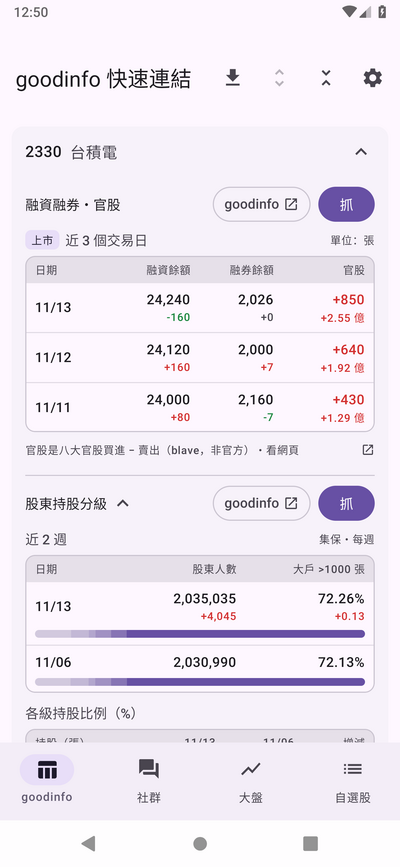
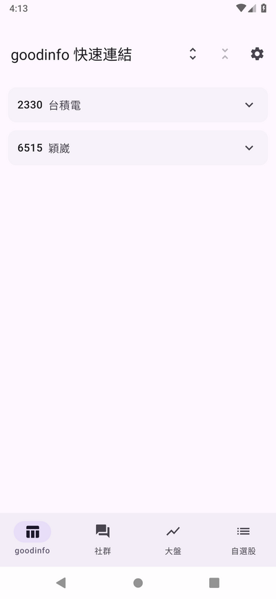
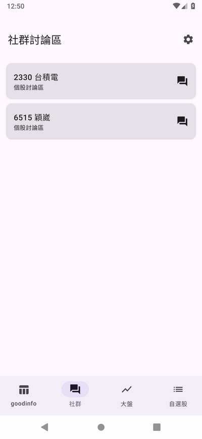
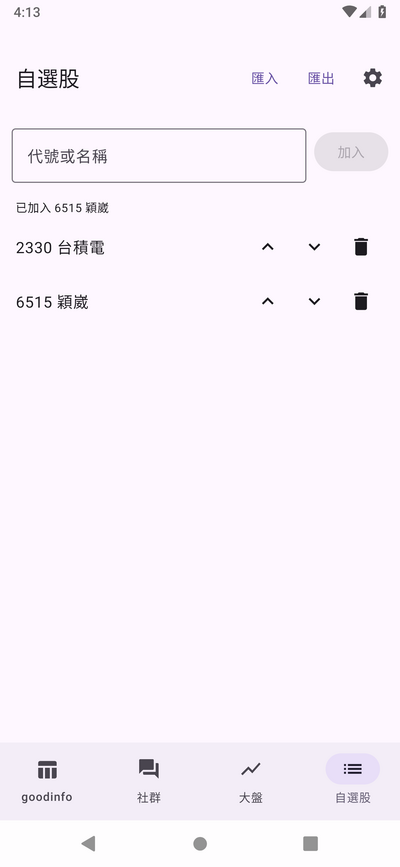
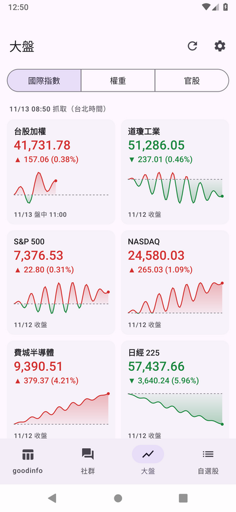
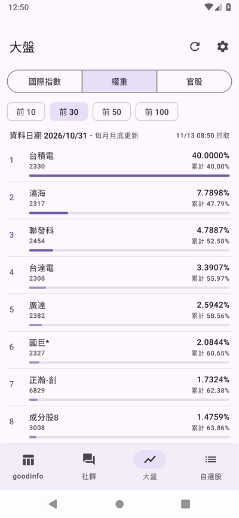
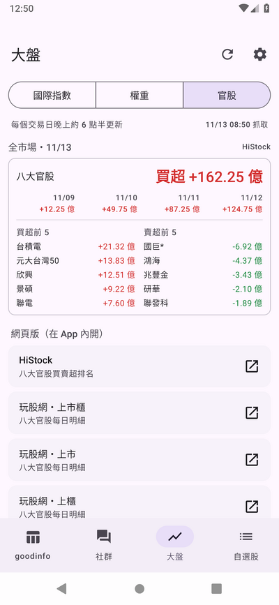
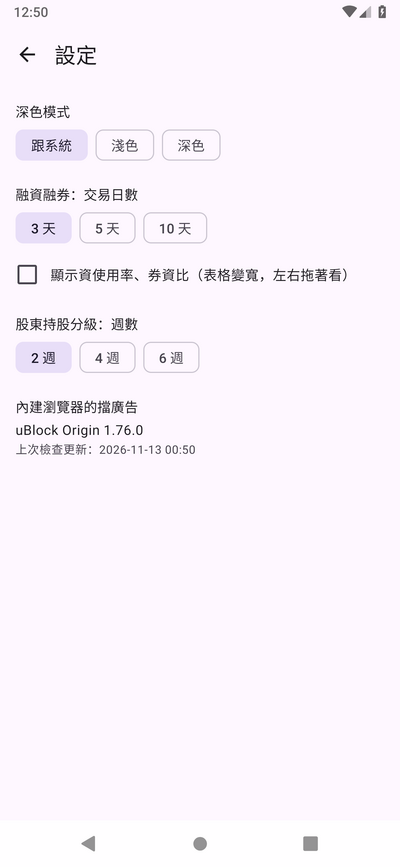

# StockDesk

看台股自選股的 Android App：goodinfo 快速連結與官方原始資料（融資融券、股東持股分級）、個股社群討論區、國際指數走勢、加權指數權重、八大官股買賣超。
自選股自己加減，匯出匯入 JSON 換手機也接得回來。

## 畫面

| goodinfo（抓官方資料） | goodinfo（收合） | 社群 | 自選股 |
|:-:|:-:|:-:|:-:|
|  |  |  |  |

| 大盤：國際指數 | 大盤：權重 | 大盤：官股 | 設定 |
|:-:|:-:|:-:|:-:|
|  |  |  |  |

截圖來自 CI 的 Android 9 模擬器（[`record.yml`](.github/workflows/record.yml)），資料來源換成假的，畫面上的數字是測試用的假資料。
更新截圖：CI 跑完後執行 `scripts/readme-screenshots.sh`。

## 功能

- **goodinfo**：自選股每一檔一鍵在 App 內建的瀏覽器頁開 goodinfo 的融資融券／股權分散頁；「抓」直接向證交所、櫃買、集保抓同一份資料的官方來源，不經 goodinfo；融資融券那一列同時抓八大官股在這一檔的買賣超（blave，上櫃股用 HiStock，非官方），併成一張表。
  標題列的「全部抓取」照順序把每一檔都抓一遍，檔與檔之間隨機停頓。
  點代號名稱收合／展開，標題列可以一鍵全部展開、全部收合
- **社群**：自選股每一檔一鍵開個股討論區網頁（內建瀏覽器頁），不用登入、不用 token
- **大盤**：三頁切換
  - **國際指數**：台股加權、道瓊、S&P 500、NASDAQ、費半、日經 225、韓國 KOSPI、恆生最近一個交易日的走勢圖（Yahoo 的資料，非官方），手動重新整理
  - **權重**：加權指數成分股市值比重前 N 名（期交所，每月月底更新），進頁面時一天抓一次
  - **官股**：八大官股（八家公股券商）的買賣超：全市場當天買超還是賣超、多少（HiStock，非官方）與買超／賣超前 5 名。進頁面時當天的數字公布後抓一次；網頁版（HiStock、玩股網）在內建瀏覽器頁開
- **自選股**：打代號或名稱搜尋加入，刪、排順序、改名、匯出匯入；每一檔底下一行八大官股最新一天的買賣超
- **內建瀏覽器**：用 GeckoView（Firefox 的引擎），內建 uBlock Origin 擋網頁上的廣告。uBlock Origin 不在 APK 裡，第一次啟動時從 Mozilla 附加元件網站下載安裝，之後一天最多檢查一次更新
- 抓回來的資料存在手機上，離線也看得到上一次的結果；只有一個權限（網路）；App 本身沒有廣告、沒有遙測

支援 Android 9 以上的 arm64 手機。因為內含 GeckoView，APK 大約 95 MB。

## 現況

功能都做了，模擬器上的測試都過；正在真機上實測，還沒發第一個正式版。進度與架構見 [`CLAUDE.md`](CLAUDE.md)。

## 下載

正式版會放在 [GitHub Release](../../releases/latest)（`stockdesk.apk`）。不上架 Google Play。

## 開發

Kotlin + Jetpack Compose，在 [claude.ai/code](https://claude.ai/code) 雲端 session 開發。
不碰 Android 的部分（資料來源、解析、節流、快取規則、自選股）是純 Kotlin 的 `core` module，用 JVM 單元測試加錄好的真實回應；
畫面的測試在 GitHub Actions 的 Android 9 模擬器上跑並錄影（[`record.yml`](.github/workflows/record.yml)）。

- 規格：[`docs/spec.md`](docs/spec.md)
- 資料來源與端點：[`docs/data-sources.md`](docs/data-sources.md)
- 架構、約定：[`CLAUDE.md`](CLAUDE.md)
- 測試、錄影、fixture：[`docs/testing.md`](docs/testing.md)
- 雲端環境設定：[`docs/cloud-setup.md`](docs/cloud-setup.md)
- 發版金鑰：[`docs/release-key.md`](docs/release-key.md)
- debug 版與 release 版差在哪：[`docs/debug-vs-release.md`](docs/debug-vs-release.md)
- 之後可能會做：[`docs/ideas.md`](docs/ideas.md)

## 注意

資料來自證交所、櫃買、集保、期交所的公開網頁／資料，國際指數來自 Yahoo 股市、八大官股來自 HiStock 與 blave（都非官方），自用／學習取向；請自行留意各自的服務條款。
程式已內建節流（兩次請求之間至少隔 1～2 秒），請勿改小或平行大量請求。

⭐ **如果這個專案對您有幫助，請給一個 Star！** ⭐

## Donation

文章都是我自己研究內化後原創，如果有幫助到您，也想鼓勵我的話，歡迎請我喝一杯咖啡 :laughing:

綠界科技ECPAY ( 不需註冊會員 )

[贊助者付款](http://bit.ly/2F7Jrha)

歐付寶 ( 需註冊會員 )

[贊助者付款](https://payment.opay.tw/Broadcaster/Donate/9E47FDEF85ABE383A0F5FC6A218606F8)

## 贊助名單

[贊助名單](https://github.com/twtrubiks/Thank-you-for-donate)
